# งานประจำของ HR ใน Cwork: ทำตามทีละขั้น

คู่มือนี้สำหรับ HR ที่เพิ่งเปิด Cwork ครั้งแรก นั่งที่เครื่องพีซีในออฟฟิศ ไม่ต้องรู้เรื่องเทคนิค
พาทำสี่งานที่ใช้บ่อยที่สุดตั้งแต่ต้นจนจบ

1. นำเข้าไฟล์จากเครื่องสแกนนิ้ว แล้วตัดสินวันที่เครื่องสรุปเองไม่ได้
2. บันทึกการลาให้พนักงาน
3. รันเงินเดือนคู่ขนานทั้งงวด 15 วันและงวดเดือน (คำนวณใน Cwork เทียบกับวิธีที่ใช้อยู่ ยังไม่ได้จ่ายจริง)
4. พิมพ์สลิปเงินเดือนและใบเซ็นรับเงิน

ภาพทุกภาพมาจากบริษัทตัวอย่างที่มากับ Cwork ชื่อและตัวเลขทั้งหมดเป็นข้อมูลสมมติ
ของบริษัทคุณจะหน้าตาเหมือนกัน แค่ชื่อกับตัวเลขต่างกัน

**ก่อนเริ่ม** ให้เข้าสู่ระบบด้วยบัญชี HR ของคุณ ถ้าเมนูไหนในคู่มือนี้ไม่ขึ้นให้คุณ
แปลว่าบัญชีนั้นยังไม่มีสิทธิ์ ให้บอกเจ้าของระบบ (เรื่องสิทธิ์อยู่ใน
[บทบาทของบัญชี](./account-roles.th.md)) งานข้อ 3 มีขั้นหนึ่งที่ **เจ้าของกิจการหรือผู้มีสิทธิ์อีกคน**
ต้องกดเอง คุณกดเองไม่ได้ จะเล่าในขั้นนั้น

---

## งานที่ 1: นำเข้าไฟล์จากเครื่องสแกนนิ้ว

ทำเดือนละครั้ง หรือทุกครั้งที่อยากดูเวลาล่าสุด ไฟล์หนึ่งไฟล์คือหนึ่งเดือน
รายละเอียดเต็มอยู่ใน [คู่มือสแกนนิ้ว](./scanner-import.th.md)

### ขั้นที่ 1 เลือกไฟล์

เมนูซ้าย หมวด **เวลาและการลา** เลือก **วันที่สแกนนิ้ว** แล้วกด **นำเข้าไฟล์**
จากนั้นกด **เลือกไฟล์** แล้วเลือกไฟล์ที่เอาออกจากเครื่องสแกน

**อย่าเปิดไฟล์ใน Excel แล้วบันทึกทับ** ใช้ไฟล์ตามที่เครื่องส่งออกมา แม้ชื่อจะลงท้าย .xls ก็ตาม

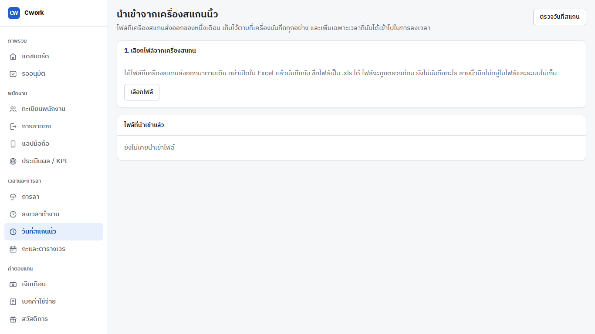

### ขั้นที่ 2 ดูว่าในไฟล์มีอะไร ยังไม่บันทึกอะไร

Cwork ตรวจไฟล์ให้ก่อน ถ้ามีบรรทัดที่อ่านไม่ได้ จะบอกเลขบรรทัดกับสิ่งที่ผิด ให้เอาไฟล์ใหม่จากเครื่อง
ถ้าไฟล์ถูกต้องจะเห็นสรุปแบบในภาพ

- **รอ HR ตัดสิน** คือวันที่เครื่องสแกนมาครั้งเดียวหรือสามครั้งขึ้นไป Cwork ไม่เดาให้
- **เลขสแกนยังไม่มีเจ้าของ** คือเลขในเครื่องที่ยังไม่ได้ผูกกับพนักงาน (ผูกได้ในขั้นที่ 4)

พอพร้อมแล้วกด **นำเข้าไฟล์นี้**

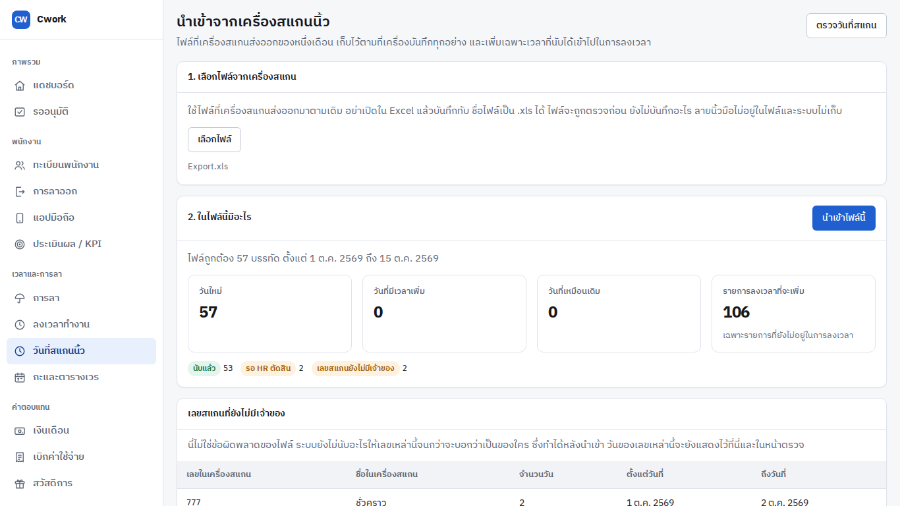

### ขั้นที่ 3 นำเข้าเสร็จแล้ว ไปตรวจวัน

หลังนำเข้า หน้าจะบอกว่าเพิ่มอะไรเข้าไปบ้าง กด **ตรวจวันที่สแกน** เพื่อไปตัดสินวันที่ยังรออยู่
นำเข้าไฟล์เดิมซ้ำได้ ไม่ซ้ำซ้อน Cwork เพิ่มเฉพาะเวลาที่ยังไม่มี

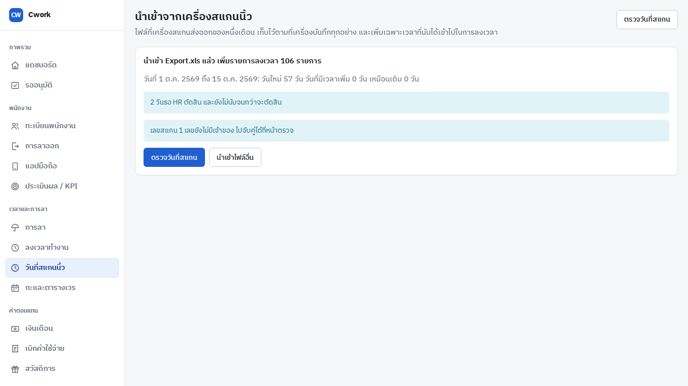

### ขั้นที่ 4 ผูกเลขสแกนที่ยังไม่มีเจ้าของ

กล่องด้านบนของหน้าตรวจแสดงเลขที่ยังไม่มีเจ้าของ พิมพ์ชื่อหรือรหัสพนักงานในช่องของแถวนั้น
เลือกคน แล้วกด **บันทึกเลขนี้** (เลขที่ยังไม่ผูกจะยังไม่ถูกนับเวลา)

ถ้าใส่เลขสแกนให้พนักงานไว้แล้วในทางอื่น เช่นตอนนำเข้ารายชื่อพนักงาน ให้กด **จับคู่ใหม่**

### ขั้นที่ 5 ตัดสินวันที่รอ HR

เลื่อนลงมาที่ตาราง **วันจากเครื่องสแกน** แต่ละแถวคือหนึ่งคนหนึ่งวัน เห็นเวลาทั้งหมดที่เครื่องบันทึก
ช่อง **เข้า** กับช่อง **ออก** คือเวลาที่ Cwork จะนับ

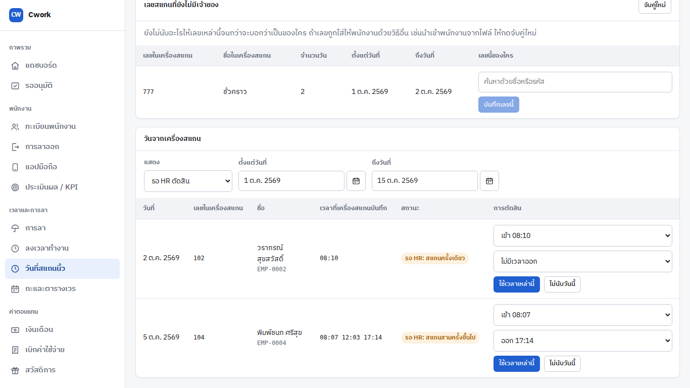

- ถ้าถูกแล้ว กด **ใช้เวลาเหล่านี้**
- ถ้าอยากเปลี่ยน เลือกเวลาเข้าหรือออกจากรายการก่อน แล้วกด **ใช้เวลาเหล่านี้**
- ถ้าวันนั้นไม่ควรนับ กด **ไม่นับวันนี้**

กดแล้วด้านบนของหน้าจะบอกว่าทำอะไรไป เช่น "พิมพ์ชนก ศรีสุข วันที่ 5 ต.ค. 2569: นับเวลา 08:07 ถึง 17:14 แล้ว"
แถวนั้นหายจากรายการที่รอ ตัวเลข **รอ HR ตัดสิน** ลดลงหนึ่ง ถ้ากดผิด เปลี่ยนใจได้ทีหลัง
โดยเลือกดู **HR เลือกเวลาแล้ว** ในช่อง **แสดง** เวลาเดิมที่เครื่องบันทึกไม่ถูกแก้เลย

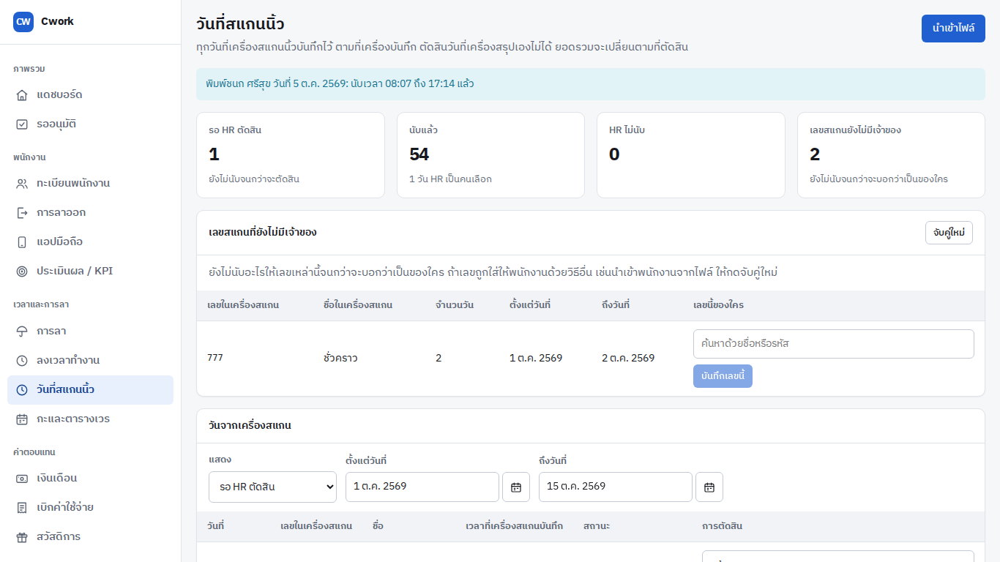

วันที่งวดเงินเดือนจ่ายไปแล้ว จะขึ้นว่า **เงินเดือนใช้วันนี้ไปแล้ว** และแก้ไม่ได้

---

## งานที่ 2: บันทึกการลาให้พนักงาน

ใช้ตอนพนักงานแจ้งลาทางโทรศัพท์หรือบอกปากเปล่า แล้ว HR ต้องบันทึกให้

### ขั้นที่ 1 เปิดหน้าการลา

เมนูซ้าย หมวด **เวลาและการลา** เลือก **การลา** รายการที่เห็นตอนแรกคือคำขอที่ **รออนุมัติ**
กดปุ่ม **+ บันทึกการลาให้พนักงาน** ที่มุมขวาบน

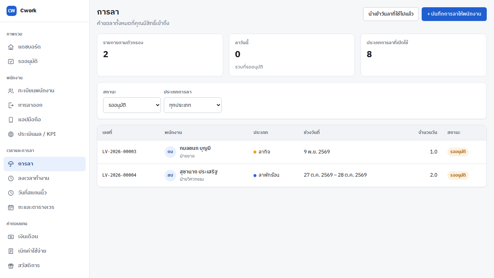

### ขั้นที่ 2 กรอกแล้วกดบันทึก

แผงจะเลื่อนออกมาทางขวา

1. ในช่อง **พนักงาน** พิมพ์ชื่อหรือรหัส แล้วกดเลือกคนที่ใช่
2. เลือก **ประเภทการลา** ใต้ช่องนี้จะบอกวันลาคงเหลือของคนนั้น
3. ใส่ **วันแรกที่ลา** กับ **ถึงวันที่** ถ้าลาวันเดียวใส่วันเดียวกันทั้งสองช่อง
   พิมพ์วันที่เป็น วัน/เดือน/ปี พ.ศ. เช่น `27/10/2569` ช่องจะเลือกข้อความเดิมให้เอง พิมพ์ทับได้เลย
4. ตรง **สถานะ** เลือก **บันทึกเป็นอนุมัติแล้ว** ถ้าหัวหน้ารู้แล้ว หรือ **ส่งให้หัวหน้าอนุมัติ**
   ถ้ายังไม่ได้ถาม
5. กล่อง **สรุปก่อนบันทึก** จะบอกหักกี่วันและเหลือกี่วัน (ไม่นับวันหยุด) ถ้าตัวเลขไม่ตรงกับที่คิด
   ให้ตรวจวันที่อีกที
6. กด **บันทึก**

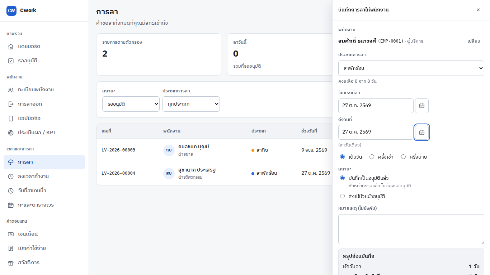

### ขั้นที่ 3 ดูว่าบันทึกแล้ว

มีข้อความที่ล่างจอว่า "บันทึกลาพักร้อนของ … แล้ว" และรายการด้านบนจะเปลี่ยนไปดูกลุ่ม **อนุมัติแล้ว**
(หรือ **รออนุมัติ** ถ้าเลือกส่งให้หัวหน้า) เพื่อให้เห็นรายการที่เพิ่งบันทึก ใต้สถานะจะบอกว่า
**บันทึกโดย** ใคร

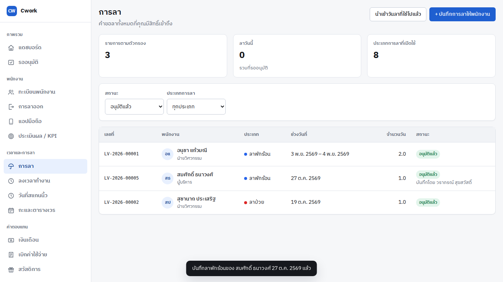

ถ้าบันทึกไม่ได้ ข้อความสีแดงในแผงจะบอกเหตุผลเป็นภาษาไทย เช่น วันลาไม่พอ หรือมีการลาซ้อนกันอยู่

---

## งานที่ 3: รันเงินเดือนคู่ขนาน

รันคู่ขนาน คือให้ Cwork คำนวณเงินเดือนของงวดเดียวกับที่คุณทำอยู่ เพื่อเทียบตัวเลข
**ยังไม่ได้จ่ายเงินใคร** ทำสองแบบตามที่บริษัทจ่ายจริง

- **งวด 15 วัน** (ลูกจ้างรายวัน จ่ายเดือนละสองครั้ง)
- **งวดเดือน** (พนักงานรายเดือน)

คำที่ควรรู้ **งวด** คือช่วงวันที่จ่ายเงิน **รอบคำนวณ** คือการคำนวณของงวดนั้น
ลำดับคือ: สร้างงวด → สร้างรอบคำนวณ → คำนวณ → ให้อีกคนอนุมัติ → พิมพ์สลิป

**ก่อนรัน** ลูกจ้างรายวันต้องตั้งค่าจ้างเป็นรายวันไว้ก่อน ที่หน้าพนักงานของคนนั้น การ์ด
**ค่าตอบแทน** กด **ตั้งค่าจ้าง** เลือก **ค่าจ้างรายวัน จ่ายเดือนละ 2 ครั้ง** แล้วใส่อัตราต่อวัน
งวด 15 วันจะจ่ายเฉพาะคนที่ตั้งแบบนี้ไว้ ส่วนงวดเดือนจ่ายเฉพาะคนที่ตั้งเป็นเงินเดือน
ถ้ารอบไหนขึ้นว่าไม่มีใครในรอบ ให้ดูที่ข้อนี้ก่อน

### ขั้นที่ 1 สร้างงวด

เมนูซ้าย หมวด **ค่าตอบแทน** เลือก **เงินเดือน** แล้วกด **+ สร้างงวดใหม่**

1. เลือกปีและเดือน
2. ช่อง **งวดการจ่าย** เลือก **ครึ่งแรก (วันที่ 1–15)** หรือ **ครึ่งหลัง (วันที่ 16–สิ้นเดือน)**
   สำหรับงวด 15 วัน หรือ **ทั้งเดือน** สำหรับงวดเดือน วันเริ่มกับวันสิ้นงวดจะใส่ให้เอง
3. **วันจ่าย** ใส่ให้เป็นวันสิ้นงวดแล้ว เปลี่ยนได้ถ้าบริษัทจ่ายวันอื่น
4. กด **สร้างงวด**

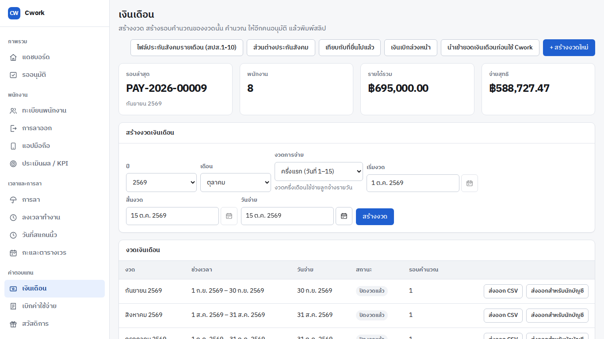

งวดใหม่จะขึ้นบนสุดของรายการ **งวดเงินเดือน**

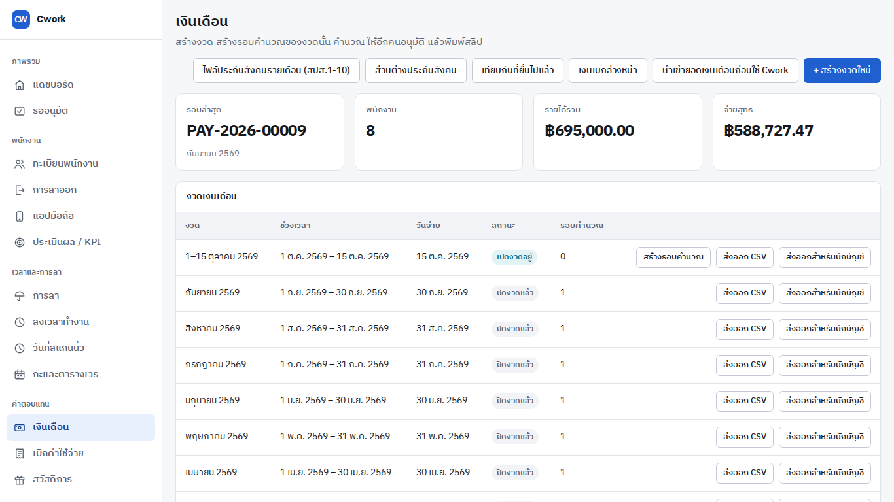

### ขั้นที่ 2 สร้างรอบคำนวณ

ที่แถวของงวดที่เพิ่งสร้าง กด **สร้างรอบคำนวณ** Cwork จะเปิดหน้ารอบนั้นให้เลย
สถานะ **ฉบับร่าง** และตัวเลขเป็นศูนย์หมด เพราะยังไม่ได้คำนวณ

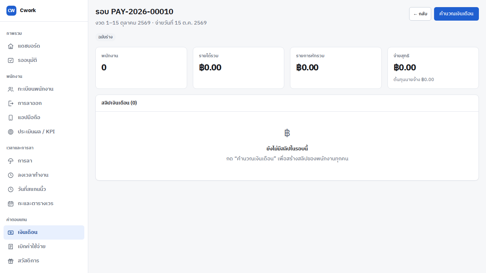

### ขั้นที่ 3 คำนวณ

กด **คำนวณเงินเดือน** ที่มุมขวาบน รอสักครู่ จะเห็นสลิปของทุกคนในรอบ

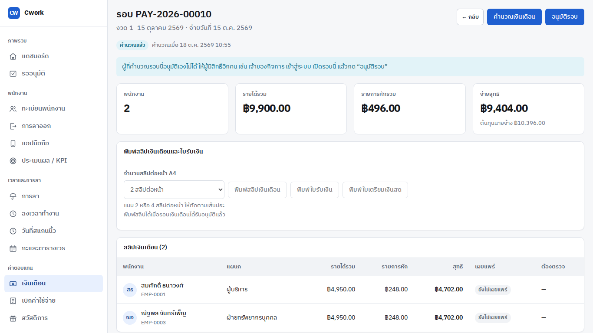

- แถบสีฟ้าด้านบนบอกว่า **คนที่คำนวณอนุมัติเองไม่ได้** (ดูขั้นที่ 4)
- กล่อง **ตรวจก่อนอนุมัติ** (ถ้ามี) บอกว่าสลิปของใครมีอะไรให้ดู เช่นวันทำงานที่ไม่มีเวลาสแกนและไม่มีการลา
  ซึ่ง Cwork จะไม่จ่ายวันนั้น ถ้าไม่ใช่ความจริง ให้กลับไปแก้เวลาหรือการลาก่อน แล้วกดคำนวณใหม่ได้เสมอ
- ถ้าเห็น **ยังไม่มีสลิปในรอบนี้** หรือมีแถบเหลืองบอกชื่อพนักงานที่ไม่อยู่ในรอบ ให้อ่านข้อความนั้น
  มันบอกว่าต้องไปตั้งค่าจ้างของใคร ตั้งแล้วกดคำนวณอีกครั้ง

ทำงวดเดือนซ้ำด้วยวิธีเดียวกัน โดยเลือก **ทั้งเดือน** ในขั้นที่ 1

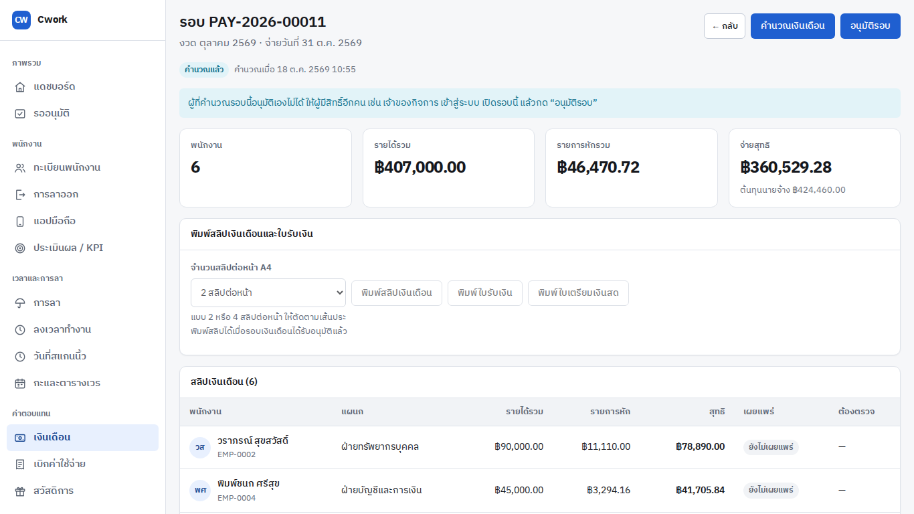

### ขั้นที่ 4 ให้อีกคนอนุมัติ

กติกาของ Cwork คือ **คนที่คำนวณรอบหนึ่งอนุมัติรอบนั้นเองไม่ได้** ต้องเป็นผู้มีสิทธิ์อีกคน เช่นเจ้าของกิจการ
ให้ท่านเข้าสู่ระบบด้วยบัญชีของท่านเอง เปิดเมนู **เงินเดือน** เปิดรอบที่ต้องการ (กด **เปิดดู** ในตาราง
**รอบการคำนวณ**) ดูตัวเลขแล้วกด **อนุมัติรอบ**

### ขั้นที่ 5 อย่ากด "บันทึกการจ่าย" ตอนรันคู่ขนาน

หลังอนุมัติ ปุ่มที่เหลือที่มุมขวาบนคือ **บันทึกการจ่ายและเผยแพร่สลิป** ปุ่มนี้คือการบอก Cwork ว่า
จ่ายเงินจริงแล้ว สลิปจะถูกเผยแพร่ และวันสแกนของเดือนนั้นจะแก้ไม่ได้อีก **ตอนรันคู่ขนานไม่ต้องกด**
หยุดที่การพิมพ์สลิปด้านล่าง

---

## งานที่ 4: พิมพ์สลิปเงินเดือนและใบเซ็นรับเงิน

พิมพ์ได้เมื่อรอบ **อนุมัติแล้ว** เท่านั้น ก่อนหน้านั้นปุ่มจะกดไม่ได้
รายละเอียดเต็มอยู่ใน [คู่มือพิมพ์สลิป](./printing-payslips.th.md)

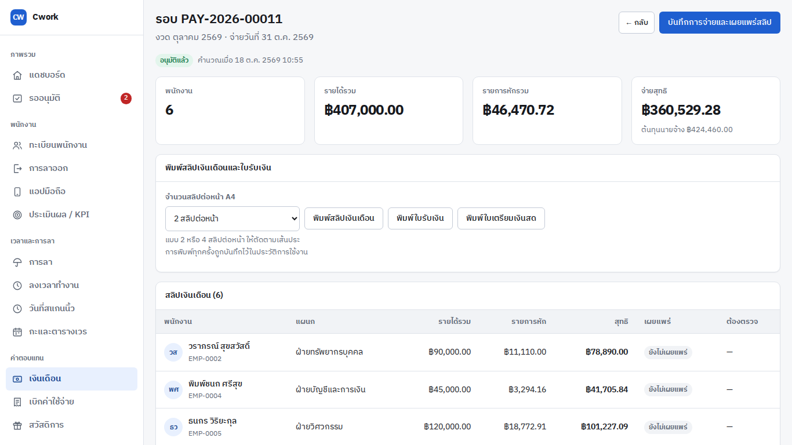

1. เปิดรอบที่อนุมัติแล้ว ดูการ์ด **พิมพ์สลิปเงินเดือนและใบรับเงิน**
2. เลือก **จำนวนสลิปต่อหน้า A4** (1, 2 หรือ 4 สลิป สองแบบหลังมีเส้นประให้ตัด)
3. กด **พิมพ์สลิปเงินเดือน** เพื่อได้สลิปของทุกคน หรือกด **พิมพ์ใบรับเงิน** เพื่อได้แผ่นรายชื่อ
   ให้พนักงานเซ็นรับเงิน (ถ้าจ่ายเงินสด กด **พิมพ์ใบเตรียมเงินสด** ได้ใบนับธนบัตรด้วย)
4. ไฟล์ PDF จะเปิดในแท็บใหม่ สั่งพิมพ์จากเบราว์เซอร์ เลือกกระดาษ A4 และขนาด 100%

ทุกการพิมพ์ถูกบันทึกไว้ในประวัติการใช้งาน ถ้า Cwork บอกว่าสลิปของใครไม่ลงตัว ให้กลับไปกด
**คำนวณเงินเดือน** ใหม่ที่รอบนั้น

---

## ติดขัดตรงไหน

- **ปุ่มกดไม่ได้หรือเมนูไม่ขึ้น** บัญชีของคุณยังไม่มีสิทธิ์ ให้เจ้าของระบบดู [บทบาทของบัญชี](./account-roles.th.md)
- **เลขสแกนไม่มีเจ้าของ** ผูกที่หน้า **วันที่สแกนนิ้ว** (งานที่ 1 ขั้นที่ 4)
- **รอบคำนวณไม่มีสลิป** ดูข้อความที่หน้ารอบ แล้วตั้งค่าจ้างของพนักงาน (งานที่ 3 ก่อนรัน)
- **อนุมัติรอบของตัวเองไม่ได้** เป็นกติกา ให้ผู้มีสิทธิ์อีกคนทำ
- **เจออย่างอื่น** กดแจ้งปัญหาจากในระบบได้ ไม่มีข้อมูลส่วนตัวติดไป
  [คู่มือแจ้งปัญหา](./report-a-problem.th.md)

ภาพในคู่มือนี้สร้างด้วย `node docs/guide/capture-hr-tasks.mjs` ถ้าหน้าจอเปลี่ยน ให้รันใหม่
