# งานประจำของ HR ใน Cwork: ทำตามทีละขั้น

คู่มือนี้สำหรับ HR ที่เพิ่งเปิด Cwork ครั้งแรก นั่งที่เครื่องพีซีในออฟฟิศ ไม่ต้องรู้เรื่องเทคนิค
พาทำสี่งานที่ใช้บ่อยที่สุดตั้งแต่ต้นจนจบ

1. นำเข้าไฟล์จากเครื่องสแกนนิ้ว แล้วตัดสินวันที่เครื่องสรุปเองไม่ได้
2. บันทึกการลาให้พนักงาน
3. รันเงินเดือนคู่ขนานทั้งงวด 15 วันและงวดเดือน (คำนวณใน Cwork เทียบกับวิธีที่ใช้อยู่ ยังไม่ได้จ่ายจริง)
4. พิมพ์สลิปเงินเดือนและใบเซ็นรับเงิน

ภาพทุกภาพมาจากบริษัทตัวอย่างที่มากับ Cwork ชื่อและตัวเลขทั้งหมดเป็นข้อมูลสมมติ
ของบริษัทคุณจะหน้าตาเหมือนกัน แค่ชื่อกับตัวเลขต่างกัน

## ก่อนเริ่ม: เข้าสู่ระบบ

ต้องมีมือถือที่ลงแอปยืนยันตัวตน (Authenticator) ไว้ เช่น Google Authenticator หรือ Microsoft Authenticator

1. ใส่ **อีเมล** กับ **รหัสผ่าน** ของบัญชี HR แล้วกด **เข้าสู่ระบบ**
2. จะขึ้นหน้า **ยืนยันตัวตนสองขั้นตอน** เปิดแอปบนมือถือ ดูรหัส 6 หลักของ Cwork
   พิมพ์ลงช่อง **รหัสยืนยัน** แล้วกด **ยืนยัน**
3. รหัสในแอปเปลี่ยนทุก 30 วินาที ถ้าขึ้นว่ารหัสไม่ถูก ให้รอรหัสถัดไปแล้วลองใหม่
   รหัสที่ใช้เข้าระบบไปแล้วใช้ซ้ำไม่ได้ ถ้าเพิ่งออกจากระบบแล้วเข้าใหม่ทันที ให้รอรหัสถัดไปก่อน

**ครั้งแรกที่เข้าระบบ** บัญชีที่ทำเงินเดือนได้จะเจอหน้า **ตั้งค่ายืนยันตัวตนสองขั้นตอน** ก่อน
เปิดแอปบนมือถือ เพิ่มบัญชีใหม่ด้วยการสแกน QR บนจอ (หรือพิมพ์คีย์ที่อยู่ใต้ QR เอง)
พิมพ์รหัส 6 หลักที่แอปขึ้นให้ แล้วกด **เปิดใช้งาน** จากนั้น Cwork จะแสดง **รหัสสำรอง** ให้ครั้งเดียว
จดเก็บไว้ในที่ปลอดภัย แล้วกด **บันทึกแล้ว เข้าสู่ระบบ** วันที่ไม่มีมือถืออยู่กับตัว ใช้รหัสสำรองแทนรหัส 6 หลักได้
หนึ่งรหัสต่อหนึ่งครั้ง

ถ้าเมนูไหนในคู่มือนี้ไม่ขึ้นให้คุณ
แปลว่าบัญชีนั้นยังไม่มีสิทธิ์ ให้บอกเจ้าของระบบ (เรื่องสิทธิ์อยู่ใน
[บทบาทของบัญชี](./account-roles.th.md)) งานข้อ 3 มีขั้นหนึ่งที่ **เจ้าของกิจการหรือผู้มีสิทธิ์อีกคน**
ต้องกดเอง คุณกดเองไม่ได้ จะเล่าในขั้นนั้น

---

## งานที่ 1: นำเข้าไฟล์จากเครื่องสแกนนิ้ว

ทำเดือนละครั้ง หรือทุกครั้งที่อยากดูเวลาล่าสุด ไฟล์หนึ่งไฟล์คือหนึ่งเดือน
รายละเอียดเต็มอยู่ใน [คู่มือสแกนนิ้ว](./scanner-import.th.md)

### ขั้นที่ 1 เลือกไฟล์

เมนูซ้าย หมวด **เวลาและการลา** เลือก **วันที่สแกนนิ้ว** แล้วกด **นำเข้าไฟล์**
จากนั้นกด **เลือกไฟล์** แล้วเลือกไฟล์ที่เอาออกจากเครื่องสแกน

**อย่าเปิดไฟล์ใน Excel แล้วบันทึกทับ** ใช้ไฟล์ตามที่เครื่องส่งออกมา แม้ชื่อจะลงท้าย .xls ก็ตาม

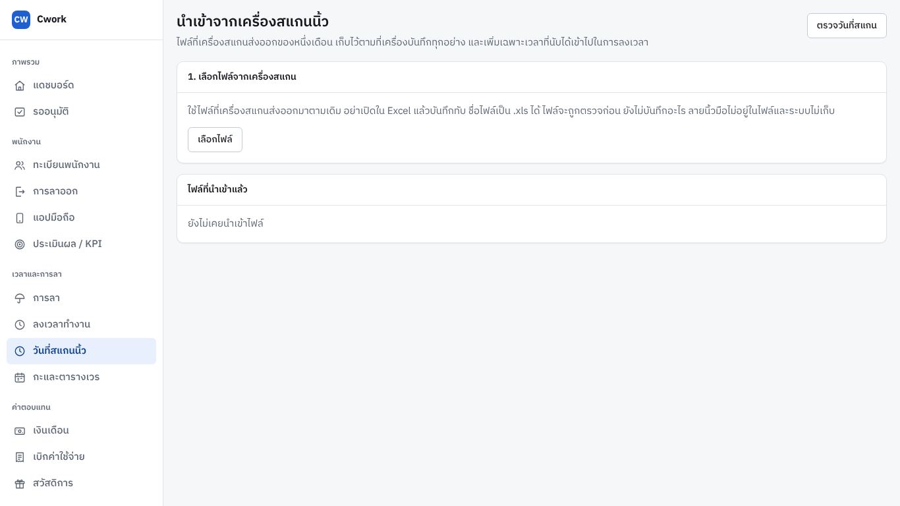

### ขั้นที่ 2 ดูว่าในไฟล์มีอะไร ยังไม่บันทึกอะไร

Cwork ตรวจไฟล์ให้ก่อน ถ้ามีบรรทัดที่อ่านไม่ได้ จะบอกเลขบรรทัดกับสิ่งที่ผิด ให้เอาไฟล์ใหม่จากเครื่อง
ถ้าไฟล์ถูกต้องจะเห็นสรุปแบบในภาพ

- **รอ HR ตัดสิน** คือวันที่เครื่องสแกนมาครั้งเดียวหรือสามครั้งขึ้นไป Cwork ไม่เดาให้
- **เลขสแกนยังไม่มีเจ้าของ** คือเลขในเครื่องที่ยังไม่ได้ผูกกับพนักงาน (ผูกได้ในขั้นที่ 4)

พอพร้อมแล้วกด **นำเข้าไฟล์นี้**

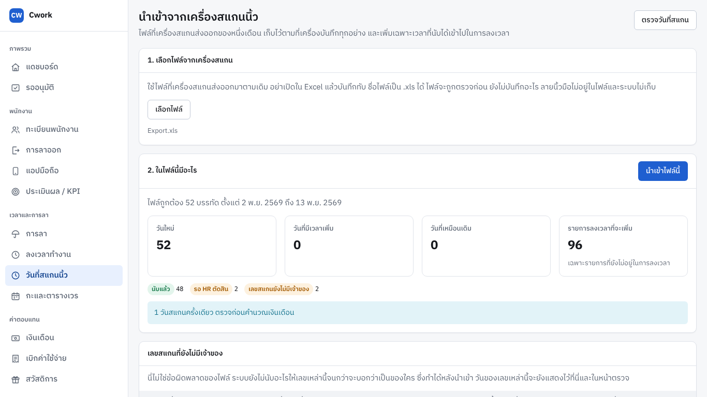

### ขั้นที่ 3 นำเข้าเสร็จแล้ว ไปตรวจวัน

หลังนำเข้า หน้าจะบอกว่าเพิ่มอะไรเข้าไปบ้าง ถ้ามีวันที่สแกนครั้งเดียว จะบอกจำนวนไว้ด้วย
เช่น "1 วันสแกนครั้งเดียว ตรวจก่อนคำนวณเงินเดือน" กด **ตรวจวันที่สแกน** เพื่อไปตัดสินวันที่ยังรออยู่
นำเข้าไฟล์เดิมซ้ำได้ ไม่ซ้ำซ้อน Cwork เพิ่มเฉพาะเวลาที่ยังไม่มี

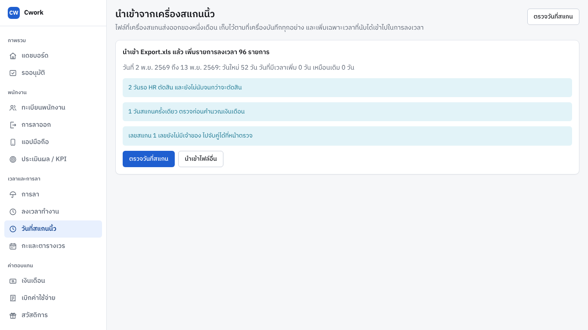

### ขั้นที่ 4 ผูกเลขสแกนที่ยังไม่มีเจ้าของ

กล่องด้านบนของหน้าตรวจแสดงเลขที่ยังไม่มีเจ้าของ พิมพ์ชื่อหรือรหัสพนักงานในช่องของแถวนั้น
เลือกคน แล้วเลือกว่าเลขนี้เป็นของคนนี้นานแค่ไหน ก่อนกด **บันทึกเลขนี้** (เลขที่ยังไม่ผูกจะยังไม่ถูกนับเวลา)

- **เฉพาะวันเหล่านี้** ช่วงวันที่ในวงเล็บคือวันแรกถึงวันสุดท้ายที่เลขนี้ค้างอยู่ ทุกวันในช่วงนั้นจะนับให้คนนี้
  ใช้เมื่อวันทั้งหมดในช่วงนั้นเป็นของคนนี้คนเดียว เช่นเขายืมบัตรของคนอื่นไปใช้สองสามวัน
  วันของเลขเดียวกันที่อยู่นอกช่วงนี้ยังไม่มีเจ้าของ และผูกให้คนอื่นได้ ถ้าบัตรเป็นของเขาแค่บางช่วง
  เลือก **วันแรก** และ **วันสุดท้าย** ที่ช่องถัดมาได้ (เริ่มต้นเป็นทั้งช่วง) ระบบบอกจำนวนวันที่จะนับก่อนกดบันทึก
  และเตือนถ้าคนนี้มีสแกนจากเลขอื่นของตัวเองอยู่แล้วในวันเหล่านั้น เพราะสแกนของสองเลขจะนับรวมเป็นวันเดียวกัน
- **ตั้งแต่ต้นจนกว่าจะสิ้นสุด** (หรือ **ตั้งแต่ วันที่… จนกว่าจะสิ้นสุด** ถ้าเลขนี้เคยเป็นของคนอื่นมาก่อน)
  ใช้เมื่อเลขนี้เป็นของเขาตั้งแต่วันนั้นไป เลขนี้จะเป็นเลขที่เขาใช้อยู่ ในวงเล็บบอกว่าจะนับวันที่รออยู่ให้กี่วัน
  เลือกได้เฉพาะคนที่ยังไม่มีเลขที่ใช้อยู่

กด **บันทึกเลขนี้** แล้ว Cwork นับให้ทันที ไม่มีหน้าต่างถามยืนยัน จึงควรอ่านช่วงวันที่ในตัวเลือกก่อนกด

**สิ้นสุดเลข** ถ้าเลขนี้หลุดจากเขาตั้งแต่วันไหนก็ตาม เปิดหน้าพนักงาน การ์ด **เลขในเครื่องสแกน** กด
**สิ้นสุดเลขนี้ในวันที่…** พิมพ์วันสุดท้ายที่เลขนี้ยังนับให้เขา (วัน/เดือน/ปี พ.ศ. เช่น 09/10/2569) แล้วกด **สิ้นสุดเลขนี้**
หน้าต่างยืนยันจะบอกว่านับให้เขาถึงวันไหน และมีกี่วันหลังจากนั้นที่จะกลับเป็นเลขที่ยังไม่มีเจ้าของ
วันก่อนหน้านั้นนับให้เขาตามเดิม ระบบไม่ให้สิ้นสุดถ้าวันหลังวันสิ้นสุดอยู่ในรอบเงินเดือนที่คำนวณหรืออนุมัติแล้ว
ช่วงที่สิ้นสุดไปแล้วก็ย่นให้สั้นลงได้จากการ์ดเดียวกัน กด **สิ้นสุดให้เร็วขึ้น** ข้างช่วงนั้น เลือกวันที่เร็วกว่าเดิม
ระบบถามแบบเดียวกัน และวันที่หลุดไปกลับเป็นไม่มีเจ้าของ รอผูกให้คนที่ใช้บัตรต่อ

#### ตัวอย่าง: บัตรชั่วคราวที่สองคนใช้ต่อกันในเดือนเดียว

บัตรเลข 777 อยู่ในลิ้นชัก HR คนแรกใช้วันที่ 1–9 คนที่สองใช้ตั้งแต่วันที่ 12 ทั้งสองคนยังไม่มีเลขอื่น
ไฟล์เดือนนี้มีเลข 777 ทั้งสองช่วง กล่องเลขที่ยังไม่มีเจ้าของจึงขึ้นช่วงเดียวคือวันที่ 1 ถึง 21
ทั้งสองตัวเลือกจะนับทุกวันให้คนที่เลือก ให้ทำตามลำดับนี้

1. ที่แถวของเลข 777 เลือก **คนแรก** และ **ตั้งแต่ต้นจนกว่าจะสิ้นสุด** แล้วกด **บันทึกเลขนี้**
   (ทุกวันจะนับให้คนแรกชั่วคราว ไม่ต้องตกใจ)
2. เปิดหน้าพนักงานของคนแรก กด **สิ้นสุดเลขนี้ในวันที่…** พิมพ์วันที่ 9 แล้วกด **สิ้นสุดเลขนี้**
   หน้าต่างยืนยันควรบอกจำนวนวันที่จะกลับเป็นไม่มีเจ้าของเท่ากับวันที่คนที่สองใช้ ถ้าตรงกดยืนยัน
3. กลับไปหน้า **วันที่สแกนนิ้ว** เลข 777 จะขึ้นอีกครั้งพร้อมช่วงของคนที่สอง เลือก **คนที่สอง** และ
   **ตั้งแต่ วันที่ 10 … จนกว่าจะสิ้นสุด** (ถ้าเขายังถือบัตรอยู่) หรือ **เฉพาะวันเหล่านี้** (ถ้าคืนบัตรแล้ว) แล้วกด **บันทึกเลขนี้**
4. ตรวจผล เลือกตัวกรอง **ทุกแถว** ในตาราง **วันจากเครื่องสแกน** ดูว่าแต่ละวันของเลข 777 อยู่กับคนที่ถูกต้อง
   หรือดูช่วงวันที่ในการ์ด **เลขในเครื่องสแกน** ของแต่ละคน

ถ้ารู้ล่วงหน้าว่าใครถือบัตรช่วงไหน ทำที่หน้าพนักงานก่อนนำเข้าไฟล์ก็ได้ ให้เลขกับคนแรก (กด **เพิ่ม** พิมพ์ 777)
สิ้นสุดในวันสุดท้ายที่เขาใช้ แล้วให้เลขเดียวกันกับคนที่สอง Cwork เริ่มนับให้คนที่สองตั้งแต่วันถัดไปเอง
พอนำเข้าไฟล์ วันของเลขนั้นจะไปอยู่กับคนที่ถูกต้องเลยโดยไม่ต้องผูกที่หน้าตรวจ

ถ้าใส่เลขสแกนให้พนักงานไว้แล้วในทางอื่น เช่นตอนนำเข้ารายชื่อพนักงาน ให้กด **จับคู่ใหม่**

**ไม่รู้ว่าเลขนี้เป็นของใคร** ดูคอลัมน์ **ชื่อในเครื่องสแกน** ก่อน เป็นชื่อที่ตั้งไว้ในเครื่อง
ถ้าชื่อไม่ช่วย (เช่น "ชั่วคราว" หรือ "ทดลอง") ให้ดูที่ตัวเครื่องสแกนว่าเลขนั้นลงทะเบียนนิ้วของใครไว้
หรือดูวันและเวลาที่เลขนั้นสแกน แล้วถามหัวหน้าว่าวันนั้นใครมาทำงาน

**ยังไม่ผูกตอนนี้ได้** เวลาของเลขนั้นถูกเก็บไว้แล้ว พอผูกทีหลัง Cwork จะนับเวลาย้อนให้เองโดยไม่ต้องนำเข้าไฟล์ใหม่
ยกเว้นวันที่งวดเงินเดือนจ่ายไปแล้ว

**กระทบเงินเดือนไหม** ระหว่างที่ยังไม่ผูก เวลาของเลขนั้นไม่ถูกนับให้ใครเลย ถ้าเลขนั้นเป็นของลูกจ้างรายวัน
วันนั้นจะไม่ได้ค่าแรง จึงต้องผูกให้เสร็จ **ก่อนกดคำนวณเงินเดือน** ถ้าเป็นเลขที่ไม่ใช่ของพนักงานคนไหน
เช่นเลขที่ช่างใช้ทดสอบเครื่อง ปล่อยไว้ได้ ไม่มีผลกับเงินเดือนของใคร

### ขั้นที่ 5 ตัดสินวันที่รอ HR

เลื่อนลงมาที่ตาราง **วันจากเครื่องสแกน** แต่ละแถวคือหนึ่งคนหนึ่งวัน เห็นเวลาทั้งหมดที่เครื่องบันทึก
ช่อง **เข้า** กับช่อง **ออก** คือเวลาที่ Cwork จะนับ

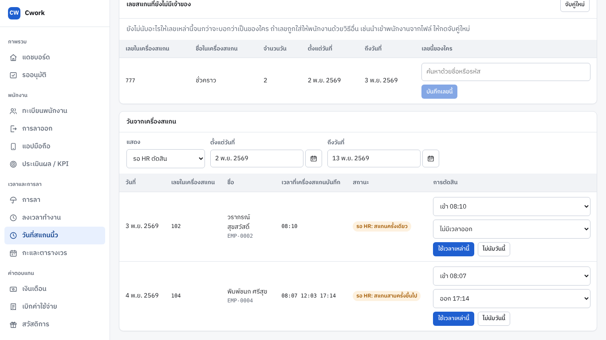

- ถ้าถูกแล้ว กด **ใช้เวลาเหล่านี้**
- ถ้าอยากเปลี่ยน เลือกเวลาเข้าหรือออกจากรายการก่อน แล้วกด **ใช้เวลาเหล่านี้**
- ถ้าวันนั้นไม่ควรนับ กด **ไม่นับวันนี้**

**วันสแกนของตัวคุณเอง** (ถ้าคุณเองก็มีรหัสสแกนและมีวันที่รอตัดสิน) ปุ่มในแถวนั้นจะกดไม่ได้ ต้องให้ผู้มีสิทธิ์จัดการเวลาทำงานคนอื่นเป็นคนตัดสิน
ถ้าในบริษัทมีคนถือสิทธิ์นี้แค่คนเดียว จะตัดสินวันของตัวเองได้ โดยหน้าจอบอกไว้ก่อน และการตัดสินนั้นจะขึ้นเป็นข้อให้ตรวจบนสลิปของคุณในรอบเงินเดือน กับถูกบันทึกในประวัติการตรวจสอบ

**วันที่สแกนครั้งเดียว** ส่วนใหญ่คือพนักงานลืมสแกนตอนเข้าหรือตอนออก ในหน้านี้เลือกได้เฉพาะเวลาที่เครื่องบันทึกไว้
พิมพ์เวลาใหม่เองไม่ได้ ให้ถามหัวหน้าหรือตัวพนักงานก่อนว่าวันนั้นมาทำงานจริงไหม

- **มาทำงานจริง แค่ลืมสแกน** ถ้าเวลาที่มีเป็นเวลาเช้า เลือกไว้ในช่อง **เข้า** แล้วเลือก **ไม่มีเวลาออก**
  ถ้าเป็นเวลาเย็น เลือก **ไม่มีเวลาเข้า** แล้วเลือกเวลานั้นในช่อง **ออก** จากนั้นกด **ใช้เวลาเหล่านี้**
  Cwork นับเป็นวันทำงานที่ลงเวลาไม่ครบ ลูกจ้างรายวันได้ค่าแรงเต็มวัน พนักงานรายเดือนไม่ถูกหัก
  แต่วันนั้นไม่มีชั่วโมงทำงาน จึงไม่มีค่าล่วงเวลา ตอนคำนวณเงินเดือน สลิปของลูกจ้างรายวันจะขึ้นในกล่อง
  **ตรวจก่อนอนุมัติ** ว่า "นับ … วันที่ลงเวลาไม่ครบเป็นวันทำงาน" ให้เห็นอีกครั้ง
- **ไม่ได้มาทำงาน** กด **ไม่นับวันนี้**
- **ยังถามไม่ได้** ปล่อยไว้ก่อน วันนั้นยังไม่ถูกนับ ลูกจ้างรายวันจะไม่ได้ค่าแรงของวันนั้นจนกว่าจะตัดสิน
  และตอนคำนวณจะขึ้นในกล่อง **ตรวจก่อนอนุมัติ** ให้เห็น

กดแล้วด้านบนของหน้าจะบอกว่าทำอะไรไป เช่น "พิมพ์ชนก ศรีสุข วันที่ 5 ต.ค. 2569: นับเวลา 08:07 ถึง 17:14 แล้ว"
แถวนั้นหายจากรายการที่รอ ตัวเลข **รอ HR ตัดสิน** ลดลงหนึ่ง ถ้ากดผิด เปลี่ยนใจได้ทีหลัง
โดยเลือกดู **HR เลือกเวลาแล้ว** ในช่อง **แสดง** เวลาเดิมที่เครื่องบันทึกไม่ถูกแก้เลย

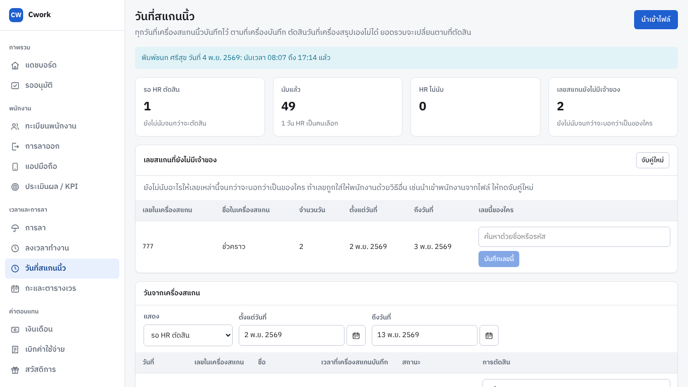

วันที่งวดเงินเดือนจ่ายไปแล้ว จะขึ้นว่า **เงินเดือนใช้วันนี้ไปแล้ว** และแก้ไม่ได้

---

## งานที่ 2: บันทึกการลาให้พนักงาน

ใช้ตอนพนักงานแจ้งลาทางโทรศัพท์หรือบอกปากเปล่า แล้ว HR ต้องบันทึกให้

### ขั้นที่ 1 เปิดหน้าการลา

เมนูซ้าย หมวด **เวลาและการลา** เลือก **การลา** รายการที่เห็นตอนแรกคือคำขอที่ **รออนุมัติ**
กดปุ่ม **+ บันทึกการลาให้พนักงาน** ที่มุมขวาบน

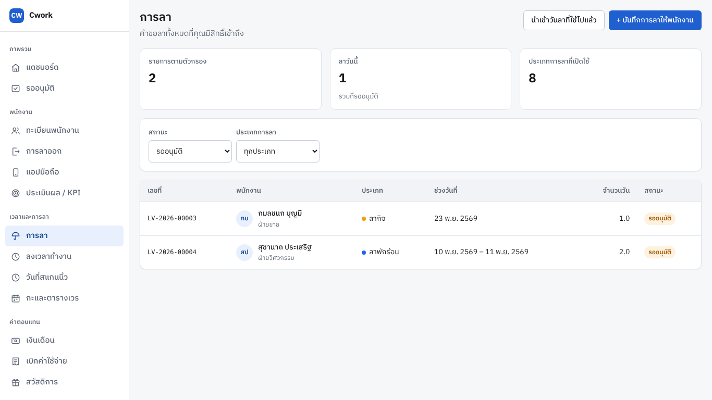

### ขั้นที่ 2 กรอกแล้วกดบันทึก

แผงจะเลื่อนออกมาทางขวา

1. ในช่อง **พนักงาน** พิมพ์ชื่อหรือรหัส แล้วกดเลือกคนที่ใช่
2. เลือก **ประเภทการลา** ใต้ช่องนี้จะบอกวันลาคงเหลือของคนนั้น
3. ใส่ **วันแรกที่ลา** กับ **ถึงวันที่** ถ้าลาวันเดียวใส่วันเดียวกันทั้งสองช่อง
   พิมพ์วันที่เป็น วัน/เดือน/ปี พ.ศ. เช่น `27/10/2569` ช่องจะเลือกข้อความเดิมให้เอง พิมพ์ทับได้เลย
4. ตรง **สถานะ** เลือก **บันทึกเป็นอนุมัติแล้ว** ถ้าหัวหน้ารู้แล้ว หรือ **ส่งให้หัวหน้าอนุมัติ**
   ถ้ายังไม่ได้ถาม
5. กล่อง **สรุปก่อนบันทึก** จะบอกหักกี่วันและเหลือกี่วัน (ไม่นับวันหยุด) ถ้าตัวเลขไม่ตรงกับที่คิด
   ให้ตรวจวันที่อีกที
6. กด **บันทึก**

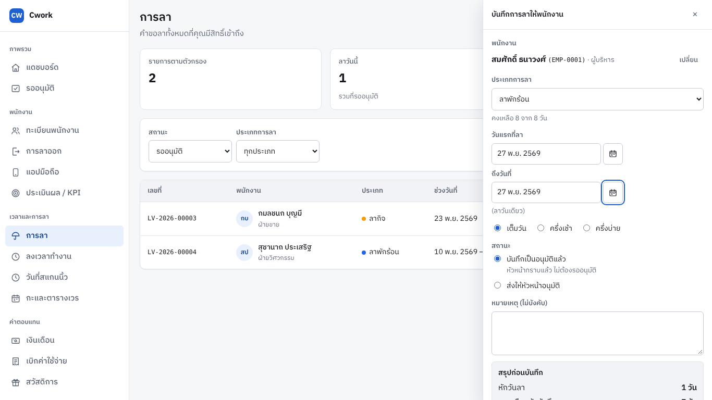

### ขั้นที่ 3 ดูว่าบันทึกแล้ว

มีข้อความที่ล่างจอว่า "บันทึกลาพักร้อนของ … แล้ว" และรายการด้านบนจะเปลี่ยนไปดูกลุ่ม **อนุมัติแล้ว**
(หรือ **รออนุมัติ** ถ้าเลือกส่งให้หัวหน้า) เพื่อให้เห็นรายการที่เพิ่งบันทึก ใต้สถานะจะบอกว่า
**บันทึกโดย** ใคร

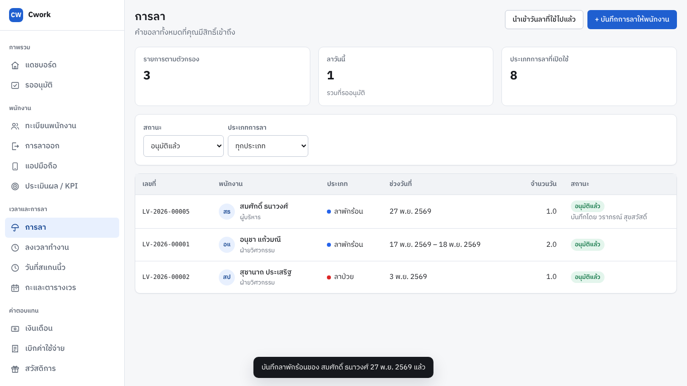

ถ้าบันทึกไม่ได้ ข้อความสีแดงในแผงจะบอกเหตุผลเป็นภาษาไทย เช่น วันลาไม่พอ หรือมีการลาซ้อนกันอยู่

---

## งานที่ 3: รันเงินเดือนคู่ขนาน

รันคู่ขนาน คือให้ Cwork คำนวณเงินเดือนของงวดเดียวกับที่คุณทำอยู่ เพื่อเทียบตัวเลข
**ยังไม่ได้จ่ายเงินใคร** ทำสองแบบตามที่บริษัทจ่ายจริง

- **งวด 15 วัน** (ลูกจ้างรายวัน จ่ายเดือนละสองครั้ง)
- **งวดเดือน** (พนักงานรายเดือน)

คำที่ควรรู้ **งวด** คือช่วงวันที่จ่ายเงิน **รอบคำนวณ** คือการคำนวณของงวดนั้น
แต่ละรอบทำตามลำดับเดียวกัน: สร้างงวด → สร้างรอบคำนวณ → คำนวณ → ให้อีกคนอนุมัติ

**ลำดับของทั้งเดือน** งวด 15 วันต้องทำทีละครึ่ง เพราะครึ่งหลังคำนวณต่อจากยอดของครึ่งแรก
(เช่นประกันสังคมกับภาษีทั้งเดือน) Cwork จึงไม่ให้คำนวณครึ่งหลังจนกว่าครึ่งแรกจะอนุมัติแล้ว

1. **ครึ่งแรก** (วันที่ 1–15) ทำจนถึงขั้นอนุมัติ
2. **ครึ่งหลัง** (วันที่ 16–สิ้นเดือน) ทำจนถึงขั้นอนุมัติ
3. **งวดเดือน** ของพนักงานรายเดือน ทำเมื่อไหร่ก็ได้ในเดือนนั้น ไม่ต้องรอครึ่งไหน
4. เมื่อทุกรอบของเดือนอนุมัติแล้ว **เทียบตัวเลข** (ขั้นที่ 5) แล้ว **พิมพ์สลิป** (งานที่ 4)

ผู้อนุมัติจึงต้องเข้ามาอย่างน้อยสองครั้งต่อเดือน ครั้งแรกหลังครึ่งแรก อีกครั้งหลังครึ่งหลังกับงวดเดือน
นัดท่านไว้ล่วงหน้า ถ้ากดคำนวณครึ่งหลังก่อน หน้ารอบจะขึ้นแถบสีส้มบอกว่าต้องอนุมัติครึ่งแรกก่อน
พร้อมลิงก์ไปที่รอบของครึ่งแรก

> **ตลอดช่วงรันคู่ขนาน ห้ามกด "บันทึกการจ่ายและเผยแพร่สลิป"** ปุ่มนี้ขึ้นเด่นที่สุดหลังอนุมัติ
> แต่กดแล้วย้อนไม่ได้ (ดูขั้นที่ 6) หน้าจอจะถามยืนยันก่อนเสมอ ให้กด **ยังไม่กด**

**ก่อนรัน** ลูกจ้างรายวันต้องตั้งค่าจ้างเป็นรายวันไว้ก่อน ที่หน้าพนักงานของคนนั้น การ์ด
**ค่าจ้าง** กด **ตั้งค่าจ้าง** (ถ้าพนักงานมีค่าจ้างอยู่แล้ว ปุ่มจะเขียนว่า **เปลี่ยนค่าจ้าง**)
เลือก **ค่าจ้างรายวัน จ่ายเดือนละ 2 ครั้ง** แล้วใส่อัตราต่อวัน
งวด 15 วันจะจ่ายเฉพาะคนที่ตั้งแบบนี้ไว้ ส่วนงวดเดือนจ่ายเฉพาะคนที่ตั้งเป็นเงินเดือน
ถ้ารอบไหนขึ้นว่าไม่มีใครในรอบ ให้ดูที่ข้อนี้ก่อน

### ขั้นที่ 1 สร้างงวด

เมนูซ้าย หมวด **ค่าตอบแทน** เลือก **เงินเดือน** แล้วกด **+ สร้างงวดใหม่**

1. เลือกปีและเดือน ฟอร์มเปิดที่เดือนปัจจุบัน ตรวจให้ตรงกับเดือนที่จะรันก่อน
2. ช่อง **งวดการจ่าย** เลือก **ครึ่งแรก (วันที่ 1–15)** หรือ **ครึ่งหลัง (วันที่ 16–สิ้นเดือน)**
   สำหรับงวด 15 วัน หรือ **ทั้งเดือน** สำหรับงวดเดือน วันเริ่มกับวันสิ้นงวดจะใส่ให้เอง
3. **วันจ่าย** ใส่ให้เป็นวันสิ้นงวดแล้ว เปลี่ยนได้ถ้าบริษัทจ่ายวันอื่น
4. กด **สร้างงวด**

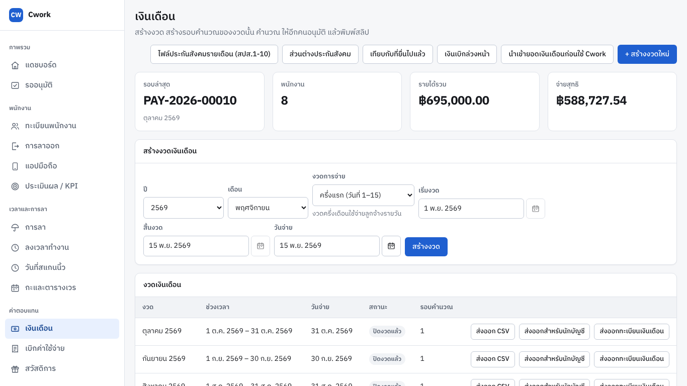

งวดใหม่จะขึ้นบนสุดของรายการ **งวดเงินเดือน**

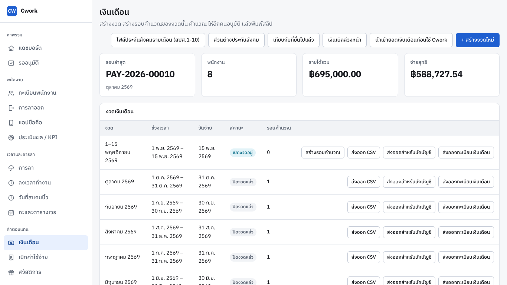

### ขั้นที่ 2 สร้างรอบคำนวณ

ที่แถวของงวดที่เพิ่งสร้าง กด **สร้างรอบคำนวณ** Cwork จะเปิดหน้ารอบนั้นให้เลย
สถานะ **ฉบับร่าง** และตัวเลขเป็นศูนย์หมด เพราะยังไม่ได้คำนวณ
ถ้างวดนั้นมีรอบคำนวณอยู่แล้ว แถวจะมีปุ่ม **เปิดรอบ** แทน ให้กดเปิดรอบเดิม ไม่ต้องสร้างใหม่
ชื่องวดครึ่งเดือนกับงวดเดือนต่างกันแค่คำนำหน้า (เช่น "1–15 ตุลาคม 2569" กับ "ตุลาคม 2569") ดูให้ตรงแถวก่อนกด

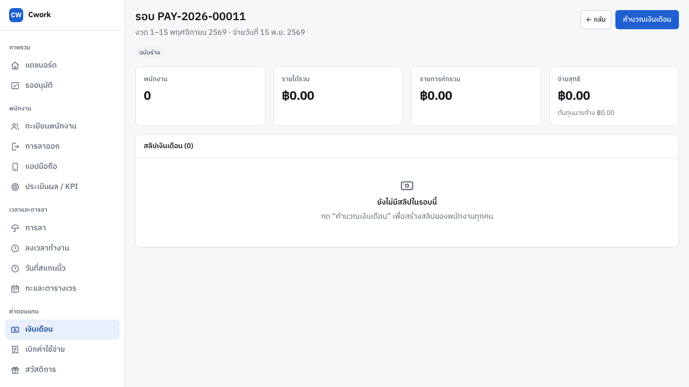

### ขั้นที่ 3 คำนวณ

กด **คำนวณเงินเดือน** ที่มุมขวาบน รอสักครู่ จะเห็นสลิปของทุกคนในรอบ

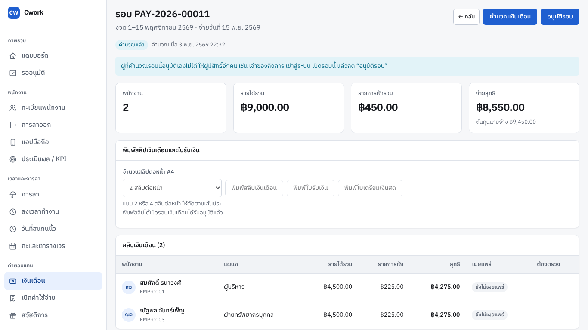

- ถ้าคุณเป็นคนสร้างหรือคำนวณรอบนี้ ปุ่ม **อนุมัติรอบ** จะเป็นสีจางและกดไม่ได้ พร้อมแถบสีฟ้าด้านบนที่บอกเหตุผลว่า **คนที่เตรียมรอบอนุมัติเองไม่ได้** (ดูขั้นที่ 4) ส่วนผู้มีสิทธิ์อีกคนจะเห็นปุ่มกดได้ตามปกติ
- กล่อง **ตรวจก่อนอนุมัติ** (ถ้ามี) บอกว่าสลิปของใครมีอะไรให้ดู เช่นวันทำงานที่ไม่มีเวลาสแกนและไม่มีการลา
  ซึ่ง Cwork จะไม่จ่ายวันนั้น ถ้าไม่ใช่ความจริง ให้กลับไปแก้เวลาหรือการลาก่อน แล้วกดคำนวณใหม่ได้เสมอ
- ถ้าเห็น **ยังไม่มีสลิปในรอบนี้** หรือมีแถบเหลืองบอกชื่อพนักงานที่ไม่อยู่ในรอบ ให้อ่านข้อความนั้น
  มันบอกว่าต้องไปตั้งค่าจ้างของใคร ตั้งแล้วกดคำนวณอีกครั้ง

ทำงวดเดือนซ้ำด้วยวิธีเดียวกัน โดยเลือก **ทั้งเดือน** ในขั้นที่ 1

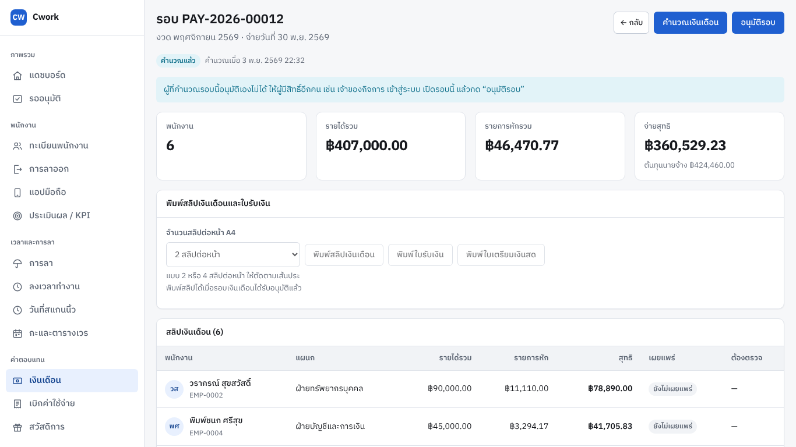

### ขั้นที่ 4 ให้อีกคนอนุมัติ

กติกาของ Cwork คือ **คนที่คำนวณรอบหนึ่งอนุมัติรอบนั้นเองไม่ได้** ต้องเป็นผู้มีสิทธิ์อีกคน เช่นเจ้าของกิจการ
ให้ท่านเข้าสู่ระบบด้วยบัญชีของท่านเอง หน้าแดชบอร์ดของท่านมีการ์ด **รอบเงินเดือนที่รอคุณอนุมัติ**
บอกจำนวนรอบที่รออยู่ กดการ์ดนั้นเพื่อไปหน้า **เงินเดือน** แล้วเลื่อนลงไปที่ตาราง **รอบการคำนวณ** กด **เปิดดู**
ที่รอบที่ต้องการ ดูตัวเลขแล้วกด **อนุมัติรอบ** Cwork จะถามยืนยันอีกหนึ่งขั้น กด **อนุมัติรอบ** ในหน้าต่างนั้นอีกครั้ง (กด **ยังไม่กด** ถ้ายังไม่แน่ใจ)
ถ้าในรอบมีสลิปของผู้อนุมัติเอง หน้าต่างจะบอกไว้ อนุมัติได้ แต่จะถูกบันทึกไว้ในประวัติการตรวจสอบ

ในตาราง **รอบการคำนวณ** รอบที่ยังรออนุมัติจะมีป้าย **รออนุมัติ** (หรือ **รอคนอื่นอนุมัติ** ถ้าคุณเป็นคนเตรียมรอบนั้นเอง)
ที่หน้าแรกของผู้มีสิทธิ์อนุมัติ การ์ด **รอบเงินเดือนที่รอคุณอนุมัติ** เปิดรอบนั้นให้เลย ถ้ามีรอบเดียว และเปิดหน้าเงินเดือนที่แสดงเฉพาะรอบเหล่านั้น ถ้ามีหลายรอบ (กด **ดูทุกรอบ** เพื่อกลับไปดูทั้งหมด)

### ขั้นที่ 5 เทียบตัวเลขกับที่ HR ทำเอง

ขั้นนี้คือเหตุผลที่รันคู่ขนาน ดูว่า Cwork คำนวณได้ตรงกับวิธีเดิมของคุณหรือไม่ ทำเดือนละครั้ง
หลังจากทุกงวดของเดือนนั้นอนุมัติแล้ว (งวดเดือน และงวด 15 วันทั้งสองงวด) Cwork เทียบทั้งเดือนในครั้งเดียว
คนที่ได้เงินหลายงวดในเดือนนั้นจะถูกรวมยอดก่อนเทียบ

**เตรียมไฟล์** ใช้ทะเบียนเงินเดือนของเดือนนั้นที่ทำด้วยวิธีเดิม (ไฟล์เดียวกับที่ส่งให้สำนักงานบัญชี)
Cwork จับคู่คนด้วย **รหัสพนักงาน** แต่ทะเบียนมีแค่ลำดับที่กับชื่อ จึงต้องเพิ่มคอลัมน์ก่อน

1. ทำสำเนาทะเบียนแล้วเปิดสำเนาใน Excel อย่าแก้ไฟล์ตัวจริงที่ส่งนักบัญชี
2. แทรกคอลัมน์ใหม่ข้างคอลัมน์ชื่อ-สกุล ตั้งหัวคอลัมน์ว่า `รหัสพนักงาน`
3. ใส่รหัสของแต่ละคนให้ตรงกับใน Cwork (ดูรหัสได้จากรายชื่อพนักงานใน Cwork)
4. บันทึกไฟล์

ประกันสังคมในไฟล์ต้องเป็นส่วนของลูกจ้างเท่านั้น ตัวเลขทุกช่องต้องกรอกครบ ช่องว่างไม่ถือเป็น 0

**เทียบ**

1. เมนู **เงินเดือน** กดปุ่ม **เทียบกับที่ยื่นไปแล้ว** ด้านบนของหน้า ชื่อปุ่มฟังเหมือนเทียบกับที่ยื่นภาษี
   แต่หน้าเดียวกันนี้รับไฟล์ของ HR ด้วย
2. ที่ช่อง **เดือน (เลือกงวดไหนของเดือนก็ได้)** เลือกงวดไหนของเดือนที่จะเทียบก็ได้ ถ้าเดือนยังไม่ครบ หน้าจอจะบอกว่าขาดงวดหรือรอบไหน
   เช่นยังไม่มีงวดเดือนของพนักงานรายเดือน หรืองวดครึ่งหลังยังไม่อนุมัติ
   (งวดครึ่งหลังคำนวณได้เมื่อรอบของครึ่งแรกอนุมัติแล้ว ไม่ต้องบันทึกการจ่ายก่อน)
3. ส่วนที่ 1 (ยอดที่ยื่นไปแล้ว) ข้ามไปได้ ตอนรันคู่ขนานยังไม่มีอะไรต้องกรอก
4. ที่ส่วนที่ 2 **ตัวเลขของ HR เอง ทีละคน** เลือกไฟล์ที่เตรียมไว้
5. ถ้าตรงกันหมด จะขึ้นว่า **ทุกตัวเลขตรงกัน** ถ้าไม่ตรง ตารางจะทำเครื่องหมายคนและคอลัมน์ที่ต่าง
   พร้อมผลต่าง และบอกคนที่มีเฉพาะในไฟล์ของคุณหรือเฉพาะใน Cwork

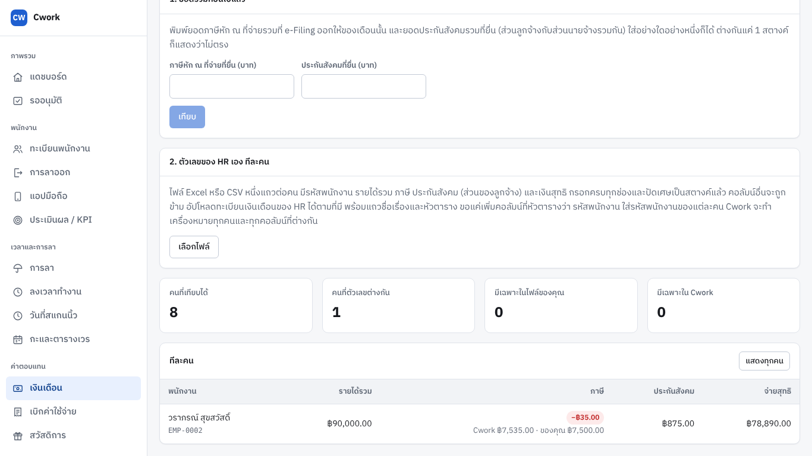

ถ้ามีคนที่ต่าง เปิดสลิปของคนนั้นใน Cwork ดูว่าต่างที่รายการไหน เช่นจำนวนวันทำงาน หรือรายการหักอย่างกองทุนสำรองเลี้ยงชีพ
แล้วจดไว้ว่าฝั่งไหนถูก ถ้าคิดว่า Cwork ผิด ให้แจ้งเจ้าของระบบ ไฟล์ที่อัปโหลดใช้เทียบเท่านั้น Cwork ไม่เก็บไว้
และไม่แก้สลิปเลย รายละเอียดเต็มอยู่ใน [คู่มือเทียบตัวเลข](./period-check.th.md)

### ขั้นที่ 6 อย่ากด "บันทึกการจ่าย" ตอนรันคู่ขนาน

หลังอนุมัติ ปุ่มที่เหลือที่มุมขวาบนคือ **บันทึกการจ่ายและเผยแพร่สลิป** ปุ่มนี้คือการบอก Cwork ว่า
จ่ายเงินจริงแล้ว สลิปจะถูกเผยแพร่และพนักงานที่มีบัญชีจะได้รับแจ้งเตือน งวดนั้นถูกปิด
วันสแกนของงวดนั้นจะแก้ไม่ได้อีก และยกเลิกรอบนั้นไม่ได้แล้ว **ตอนรันคู่ขนานไม่ต้องกด** เมื่อกดปุ่มนี้ Cwork จะถามยืนยันก่อน และบอกชัดว่าย้อนกลับไม่ได้ ถ้าเห็นข้อความเรื่องรันคู่ขนาน ให้กด **ยังไม่กด**
หยุดที่การพิมพ์สลิปด้านล่าง

---

## งานที่ 4: พิมพ์สลิปเงินเดือนและใบเซ็นรับเงิน

พิมพ์ได้เมื่อรอบ **อนุมัติแล้ว** เท่านั้น ก่อนหน้านั้นปุ่มจะกดไม่ได้
รายละเอียดเต็มอยู่ใน [คู่มือพิมพ์สลิป](./printing-payslips.th.md)

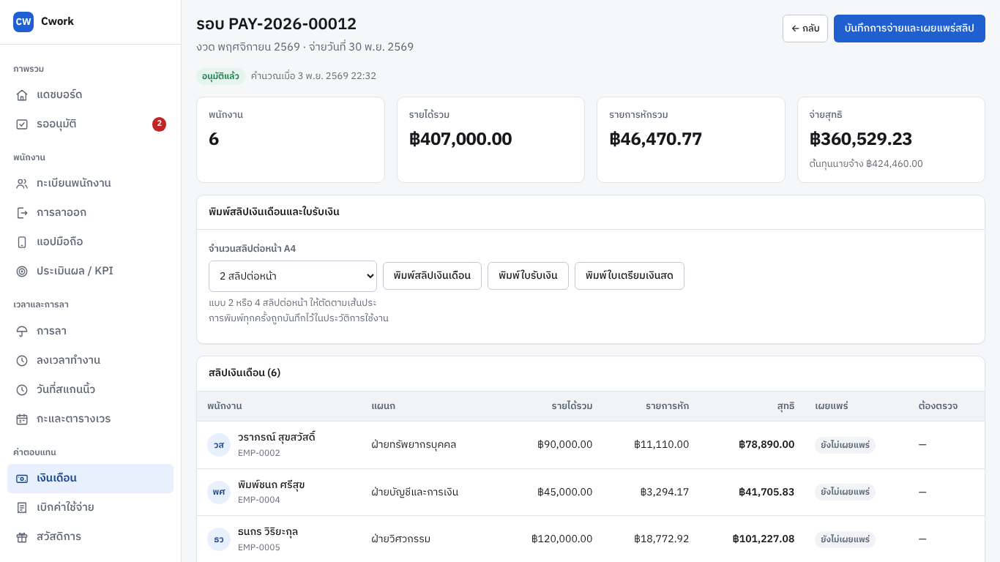

1. เปิดรอบที่อนุมัติแล้ว ดูการ์ด **พิมพ์สลิปเงินเดือนและใบรับเงิน**
2. เลือก **จำนวนสลิปต่อหน้า A4** (1, 2 หรือ 4 สลิป สองแบบหลังมีเส้นประให้ตัด)
3. กด **พิมพ์สลิปเงินเดือน** เพื่อได้สลิปของทุกคน หรือกด **พิมพ์ใบรับเงิน** เพื่อได้แผ่นรายชื่อ
   ให้พนักงานเซ็นรับเงิน (ถ้าจ่ายเงินสด กด **พิมพ์ใบเตรียมเงินสด** ได้ใบนับธนบัตรด้วย)
4. ไฟล์ PDF จะเปิดในแท็บใหม่ สั่งพิมพ์จากเบราว์เซอร์ เลือกกระดาษ A4 และขนาด 100%

ทุกการพิมพ์ถูกบันทึกไว้ในประวัติการใช้งาน ถ้า Cwork บอกว่าสลิปของใครไม่ลงตัว ให้กลับไปกด
**คำนวณเงินเดือน** ใหม่ที่รอบนั้น

---

## ติดขัดตรงไหน

- **ปุ่มกดไม่ได้หรือเมนูไม่ขึ้น** บัญชีของคุณยังไม่มีสิทธิ์ ให้เจ้าของระบบดู [บทบาทของบัญชี](./account-roles.th.md)
- **รหัสยืนยันไม่ผ่าน** รอรหัสถัดไปในแอปแล้วลองใหม่ (ก่อนเริ่ม: เข้าสู่ระบบ)
- **เลขสแกนไม่มีเจ้าของ** ผูกที่หน้า **วันที่สแกนนิ้ว** ไม่รู้ว่าเป็นของใครให้ดูงานที่ 1 ขั้นที่ 4
- **พนักงานลืมสแกนออก** งานที่ 1 ขั้นที่ 5 หัวข้อวันที่สแกนครั้งเดียว
- **ไม่รู้ว่าจะเทียบตัวเลขที่ไหน** เมนู **เงินเดือน** ปุ่ม **เทียบกับที่ยื่นไปแล้ว** (งานที่ 3 ขั้นที่ 5)
- **ไฟล์เทียบบอกว่าไม่มีคอลัมน์รหัสพนักงาน** เพิ่มคอลัมน์ `รหัสพนักงาน` ในสำเนาทะเบียน (งานที่ 3 ขั้นที่ 5)
- **รอบคำนวณไม่มีสลิป** ดูข้อความที่หน้ารอบ แล้วตั้งค่าจ้างของพนักงาน (งานที่ 3 ก่อนรัน)
- **อนุมัติรอบของตัวเองไม่ได้** เป็นกติกา ให้ผู้มีสิทธิ์อีกคนทำ
- **เจออย่างอื่น** กดแจ้งปัญหาจากในระบบได้ ระบบไม่แนบข้อมูลส่วนตัวไปเอง แต่อย่าเขียนชื่อ
  เลขบัตรประชาชน หรือเงินเดือนลงในข้อความ
  [คู่มือแจ้งปัญหา](./report-a-problem.th.md)

ภาพในคู่มือนี้สร้างด้วย `node docs/guide/capture-hr-tasks.mjs` ถ้าหน้าจอเปลี่ยน ให้รันใหม่
